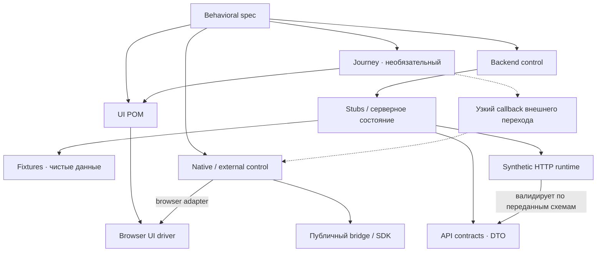

# Архитектура E2E

Читай при выборе или изменении границ слоёв. Эти правила не выбирают runner или synthetic backend; их реализацию определяет выбранный модуль.

## Разрешённые зависимости

Сплошная стрелка `A → B` разрешает A использовать публичный интерфейс B. Пунктир обозначает внедряемый узкий callback. Диаграмма описывает выполнение; fixture отдельно создаёт все необходимые зависимости и управляет lifecycle. Она не является обязательным посредником каждого вызова.

| Слой | Ответственность и граница |
| --- | --- |
| Spec | Смысл и последовательность; без прямых DOM/HTTP, stores и внутренних callbacks |
| Journey | Повторяемый UI-путь; без DTO, stubs, data fixtures и synthetic IDs |
| POM | Смысловая область UI; без backend/native controls и DTO |
| Fixture | Сборка всех зависимостей и lifecycle; без скрытых существенных действий |
| Backend control | Предметные условия и внешние серверные события; без кликов и навигации |
| External control | Публичный bridge/SDK через browser adapter; без внутренних stores и скрытых UI-действий |
| Stubs | HTTP-операции и минимальное изменяемое серверное состояние |
| Runtime | Транспорт, изоляция, политика сети и диагностика; без продуктовых сценариев |
| DTO / data fixtures | Схемы границы / чистые значения; без управления окружением |

Backend control может быть интерфейсом, возвращаемым stubs: отдельный класс или файл не обязателен. Общие чистые типы и функции не создают права обходить эти границы. Инфраструктурные `runtime/*.spec.ts` проверяют HTTP/lifecycle напрямую и не подчиняются цепочке UI-слоёв.

## Когда нужен Journey

Journey объединяет несколько POM в повторяемое пользовательское намерение. Он необязателен: spec может вызывать POM напрямую. Не создавай фасад над всеми POM и методы-переадресации только ради дополнительного слоя.

Пример: `seller.openPricingForOrder('Концерт')` уместен для проверки цены. В сценарии, который проверяет путь к форме цены, существенные переходы раскрываются. Journey не скрывает весь проверяемый flow в одном вызове.

Если путь требует внешнего возврата, fixture может передать узкий callback вроде `returnFromExternalVerification()`. Journey знает намерение, но не конкретный adapter, HTTP или DTO. Само событие должно быть понятно из публичного шага; отдельное наблюдение запроса и доставка ответа остаются в spec, когда они существенны.

## Граница POM

POM представляет страницу, форму, диалог или самостоятельную смысловую область. Компактный интерфейс скрывает локаторы, синхронизацию и mobile/desktop-различия. Не создавай POM под fixture, номер карточки, один сценарий или каждый клик. Метод над одним `click()` оправдан, когда локатор и варианты его поиска требуют локализации.

Действие и существенный результат выражаются отдельными вызовами. Внутри действия допустимы ожидания готовности и проверки завершения перехода, необходимые для надёжного выполнения. Они не заменяют явно выраженный результат сценария. POM проверяет свою область; Journey может компоновать проверки в понятный результат.

## Принципы

1. **Один тест — один законченный пользовательский результат.** Полный основной путь каждой критичной роли находится первым; альтернативы и ошибки — в secondary suites.
2. **Gherkin ↔ spec сохраняет смысл.** Условия, порядок, значимые значения, действия, внешние события и результаты понятны без чтения реализации вспомогательных объектов.
3. **Существенное видно в spec.** Ожидания записываются явно, без вычисления результата по алгоритму приложения. Технические ожидания скрываются в UI-абстракциях.
4. **Journey необязателен.** Он объединяет повторяемый путь; POM владеет смысловой областью UI. Spec может использовать оба напрямую.
5. **Границы ответственности обязательны.** Behavioral spec не работает напрямую с DOM, HTTP, stores и внутренними callbacks. Fixture собирает зависимости, не выполняя скрытые существенные действия.
6. **Действия имеют владельца.** Пользовательская операция проходит через UI, серверное внешнее событие — через backend control, ответ провайдера — через external control.
7. **HTTP-поведение проверяемо.** При выбранной browser + SSR границе оба используют согласованное synthetic HTTP-состояние. Мутации изменяют последующие ответы. Источники DTO и степень их подтверждения явны; типы и samples не выдаются за полный контракт.
8. **Состояние и время принадлежат сценарию.** Сценарии изолированы; завершение принятых запросов предшествует запуску следующего сценария.
9. **Ошибка остаётся видимой.** Нарушения контрактов и ошибки приложения проваливают тест. Сеть работает по явной политике, диагностика не раскрывает секреты.
10. **Готовность требует доказательств.** Смысловое ревью, запуск во всех настроенных профилях и необходимые проверки чувствительности дополняют друг друга. Скриншот дополняет assertions; visual baselines и committed PNG не используются.
