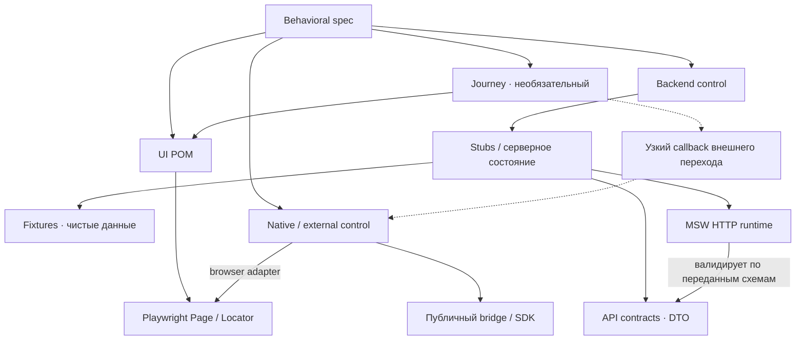

# UI-абстракции и права слоёв

**Когда читать:** изменение Journey/POM или границ зависимостей.
**Определяет:** разрешённые вызовы, выбор абстракции, локаторы и UI assertions.

## Разрешённые зависимости

Сплошная стрелка `A → B` разрешает A использовать публичный интерфейс B. Пунктир обозначает внедряемый узкий callback. Диаграмма описывает выполнение; fixture отдельно создаёт все необходимые зависимости и управляет lifecycle. Она не является обязательным посредником каждого вызова.

| Слой | Ответственность и граница |
| --- | --- |
| Spec | Смысл и последовательность; без прямых DOM/HTTP, stores и внутренних callbacks |
| Journey | Повторяемый UI-путь; без DTO, stubs, data fixtures и synthetic IDs |
| POM | Смысловая область UI; без backend/native controls и DTO |
| Fixture | Сборка всех зависимостей и lifecycle; без скрытых существенных действий |
| Backend control | Предметные условия и внешние серверные события; без кликов и навигации |
| External control | Публичный bridge/SDK через browser adapter; без внутренних stores и скрытых UI-действий |
| Stubs | HTTP-операции и минимальное изменяемое серверное состояние |
| Runtime | Транспорт, изоляция, политика сети и диагностика; без продуктовых сценариев |
| DTO / data fixtures | Схемы границы / чистые значения; без управления окружением |

Backend control может быть интерфейсом, возвращаемым stubs: отдельный класс или файл не обязателен. Общие чистые типы и функции не создают права обходить эти границы. Инфраструктурные `runtime/*.spec.ts` проверяют HTTP/lifecycle напрямую и не подчиняются цепочке UI-слоёв.

## Когда нужен Journey

Journey объединяет несколько POM в повторяемое пользовательское намерение. Он необязателен: spec может вызывать POM напрямую. Не создавай фасад над всеми POM и методы-переадресации только ради дополнительного слоя.

Пример: `seller.openPricingForOrder('Концерт')` уместен для проверки цены. В сценарии, который проверяет путь к форме цены, существенные переходы раскрываются. Journey не скрывает весь проверяемый flow в одном вызове.

Если путь требует внешнего возврата, fixture может передать узкий callback вроде `returnFromExternalVerification()`. Journey знает намерение, но не конкретный adapter, HTTP или DTO. Само событие должно быть понятно из публичного шага; отдельное наблюдение запроса и доставка ответа остаются в spec, когда они существенны.

## Граница POM

POM представляет страницу, форму, диалог или самостоятельную смысловую область. Компактный интерфейс скрывает локаторы, синхронизацию и mobile/desktop-различия. Не создавай POM под fixture, номер карточки, один сценарий или каждый клик. Метод над одним `click()` оправдан, когда локатор и варианты его поиска требуют локализации.

Действие и существенный результат выражаются отдельными вызовами. Внутри действия допустимы ожидания готовности и проверки завершения перехода, необходимые для надёжного выполнения. Они не заменяют явно выраженный результат сценария. POM проверяет свою область; Journey может компоновать проверки в понятный результат.

## Локаторы и assertions

Приоритет: `getByRole` с accessible name → `getByLabel` → семантически ограниченная область и видимый текст → стабильный пользовательский атрибут. При наличии роли диалог сначала ограничивается `getByRole('dialog')`; отсутствие роли обрабатывается по правилу долга ниже.

CSS-классы, XPath, DOM-цепочки и позиция не являются смысловой идентичностью объекта. Предпочитай существующие семантику и атрибуты; test ID не маскирует дефект доступности. Адаптивные варианты предоставляют один публичный интерфейс.

При адаптации E2E не изменяй runtime приложения ради локатора: ARIA, roles, labels и test IDs не добавляются ни в исходники, ни через тестовую DOM-инъекцию. Недостающая семантика — отдельный a11y-долг, а не повод отказаться от функционального сценария.

Если semantic locator недоступен, допустим локальный fallback в POM на существующий устойчивый атрибут или ограниченный CSS-selector. Проверь уникальность цели и наблюдаемый результат действия; свяжи POM с записью [в таблице покрытия и долга](../../skills/adapt-e2e-manifest/references/coverage.md). Не снимай неоднозначность произвольным `first()`/`nth()`, длинной DOM-цепочкой или выбором случайной карточки. Если надёжной идентификации нет, зафиксируй конкретную заблокированную проверку.

В долг входят отсутствующая семантика, текущий fallback, риск и целевой semantic locator после отдельно разрешённого исправления продукта. Функциональный успех с fallback не является a11y-покрытием; существующее нарушение доступности не скрывается из отчёта.

Ожидай наблюдаемое состояние через auto-waiting. `waitForTimeout`, полный DOM snapshot и screenshot не заменяют semantic assertion. URL проверяется в POM/Journey: точный маршрут — `toHaveURL('/path')` с `baseURL`; значимая часть — predicate по `URL.pathname`/`URL.searchParams`; regex — только для маршрута-шаблона. URL не заменяет доступную проверку содержимого.

Смысл и степень раскрытия шагов определяют [сценарии](../../docs/scenarios.md); окружение и внешние события — [controls и fixtures](../../docs/environment.md).
